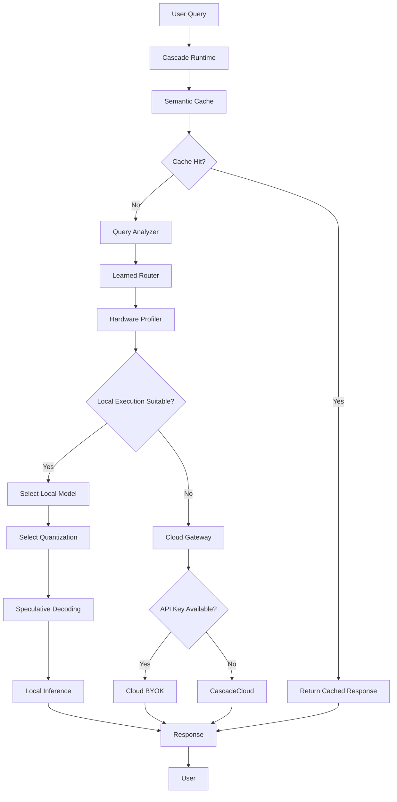
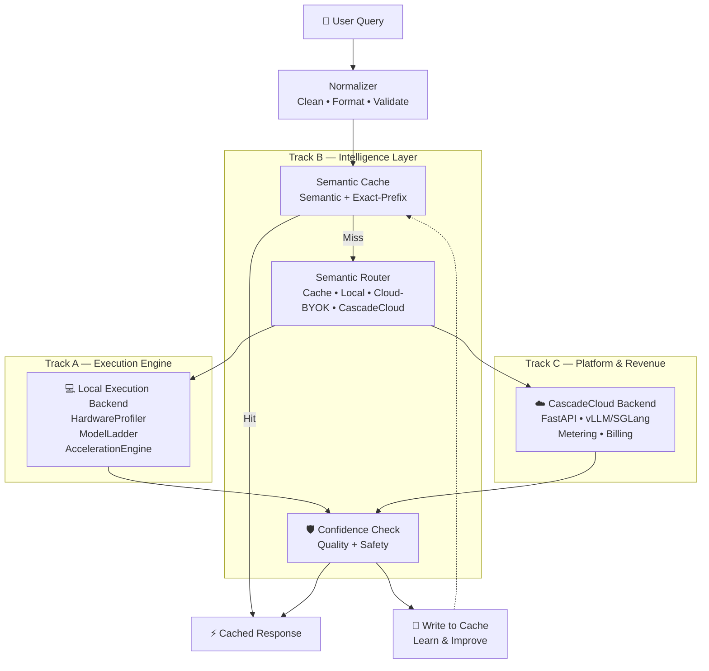

# Cascade

### Run the right model in the right place — automatically.

Cascade is a **local-first LLM runtime** that profiles your hardware, selects the best model and quantization it can realistically run, accelerates inference with speculative decoding, and automatically falls back to the cloud only when local execution is not suitable.

A **semantic cache** and **learned router** keep repeated and easy queries fast and free, while a metered, provider-agnostic gateway handles workloads that require cloud compute.

> **Note:** This README is a project overview generated from the internal **Master Requirements & Development Document (V2.2)** and its companion **Individual Task Breakdown**. It is intended to orient contributors and visitors and does not replace those documents.

---

## Table of Contents

* [Why Cascade](#why-cascade)
* [How It Works](#how-it-works)
* [Architecture](#architecture)
* [Repository Layout](#repository-layout)
* [Quickstart](#quickstart)
* [The Three Tracks](#the-three-tracks)

  * [Track A — Execution Engine](#track-a--execution-engine)
  * [Track B — Intelligence Layer](#track-b--intelligence-layer)
  * [Track C — Platform & Revenue](#track-c--platform--revenue)
* [Joint Integration Points](#joint-integration-points)
* [Roadmap](#roadmap)
* [Benchmarks](#benchmarks)
* [Contributing](#contributing)
* [License](#license)

---

## Why Cascade

Most local-LLM tooling forces users to choose between:

* Running everything locally and accepting hardware limitations
* Sending everything to the cloud and paying for every request

**Cascade removes that choice.**

For every query, Cascade automatically determines the most appropriate execution path:

| Situation                                          | Cascade's Action                           |
| -------------------------------------------------- | ------------------------------------------ |
| Query already exists in cache                      | Return cached response instantly           |
| Local hardware can handle it                       | Run locally                                |
| Local execution is possible but needs optimization | Select model + quantization + acceleration |
| Local hardware cannot handle it                    | Route to cloud                             |
| User provides their own cloud API key              | Use cloud-BYOK                             |
| User requires Cascade's hosted infrastructure      | Use CascadeCloud                           |

### The Result

* No unnecessary cloud costs
* No manual model switching
* Better utilization of local hardware
* Faster responses for repeated queries
* Automatic cloud fallback when required
* Provider-agnostic cloud infrastructure

---

## How It Works

Every request passes through the Cascade runtime, which decides where and how the query should be executed.



---


# Architecture

Cascade is organized around **three loosely coupled tracks** that share a single frozen contract.



### Architecture Responsibilities

| Layer | Responsibility | Main Components |
|---|---|---|
| **Execution** | Run models efficiently on available hardware | `HardwareProfiler`, `ModelLadder`, `AccelerationEngine` |
| **Intelligence** | Decide where each query should execute | `ContextCompressor`, `SemanticRouter`, `SemanticCache`, `Pipeline` |
| **Platform & Revenue** | Cloud execution, billing, CLI and distribution | `CascadeCloud`, Gateway, Billing, CLI |

The main cross-track contract is:

```text
shared/types.py
```

It defines the common:

- `Message`
- `HardwareProfile`
- `BackendResult`
- `ExecutionBackend`
- `PipelineResult`

Once this contract is frozen, each track can be developed independently.

---

# Repository Layout

```text
cascade/
│
├── engine/
│   ├── execution/                  # Track A
│   │   ├── hardware_profiler.py
│   │   ├── model_ladder.py
│   │   ├── acceleration_engine.py
│   │   ├── backend.py
│   │   └── tests/
│   │
│   └── intelligence/               # Track B
│       ├── pipeline.py
│       ├── context_compressor.py
│       ├── cache.py
│       ├── router/
│       │   ├── coldstart_data.py
│       │   ├── classifier.py
│       │   └── retrain.py
│       └── tests/
│
├── gateway/                         # Track C
│   ├── api/
│   ├── billing/
│   ├── providers/
│   ├── backend.py
│   └── tests/
│
├── cli/                             # Track C
│   ├── main.py
│   └── setup_wizard.py
│
├── shared/
│   └── types.py                     # Frozen cross-track contract
│
├── docs/
│   ├── quickstart.md
│   ├── config-reference.md
│   └── benchmark-report.md
│
├── scripts/
│   ├── run_benchmark.py
│   └── validate_draft_pairs.py
│
└── .github/
    └── workflows/
```

---

# Quickstart

The goal is for a new user to reach their first cached response in **under 5 minutes** on a fresh machine.

### Install

```bash
pip install cascade-cli
```

Or install directly from source:

```bash
git clone <repository-url>
cd cascade
pip install -e .
```

### Initialize Cascade

```bash
cascade init
```

The setup wizard:

- Detects available hardware
- Profiles CPU, RAM and GPU
- Selects an appropriate model configuration
- Creates `config.yaml`

### Profile Hardware

```bash
cascade profile
```

### Start an Interactive Session

```bash
cascade chat
```

### Ask a One-Shot Question

```bash
cascade ask "your question"
```

### View Statistics

```bash
cascade stats
```

Example statistics include:

```text
Cache hit rate
Local-resolution rate
Cloud usage
Speculative decoding speedup
Estimated cost saved
```

Each response is tagged with its execution tier:

```text
CACHE
LOCAL
CLOUD-BYOK
CASCADECLOUD
```

---

# The Three Tracks

Cascade is divided into three independently developable tracks.

---

## Track A — Execution Engine

### Hardware & Systems Track

The Execution Engine makes models run efficiently on whatever hardware is available.

It owns:

```text
engine/execution/
```

### Hardware Profiler

Detects:

- CPU
- RAM
- GPU vendor
- GPU VRAM
- Disk throughput

It then benchmarks available configurations and generates a versioned:

```text
HardwareProfile
```

with a `local_capable` decision.

### Model Ladder

Maintains a ranked:

```text
Model × Quantization
```

ladder.

It provides:

- Deterministic model selection
- Quantization selection
- OOM detection
- Throughput-collapse detection
- Automatic step-down
- MoE expert offloading

### Acceleration Engine

Cascade supports three speculative decoding layers:

```text
Layer 1 — Lookahead Decoding
           ↓
Layer 2 — Self-Speculative Draft Heads
           ↓
Layer 3 — Paired Draft Model
```

A real-time acceptance monitor automatically disables underperforming acceleration layers without compromising output quality.

### Target

- **≥ 1.5× token/s improvement** on Layer 2/3
- Working local rung on **≥ 90% of 8GB-RAM-or-better test machines**

---

# Track B — Intelligence Layer

### Applied ML Track

The Intelligence Layer decides what should happen with every query and remembers previous answers.

It owns:

```text
engine/intelligence/
```

### Context Compressor

Ranks conversation turns according to relevance using embedding similarity.

Low-relevance context can be:

- Summarized
- Dropped
- Retained when relevant

The compressor is designed as a pure, I/O-free function.

### Semantic Router

The router determines the best execution path:

```text
CACHE
LOCAL
CLOUD-BYOK
CASCADECLOUD
```

The initial router uses lightweight models such as:

- Logistic Regression
- Gradient-Boosted Trees

It is bootstrapped using RouteLLM's public cold-start dataset.

The router produces:

```text
Route + Confidence Score
```

When available, token-level log probabilities or entropy can provide additional routing signals.

A shadow-labeling pipeline can continuously collect retraining data from live traffic without affecting served responses.

### Semantic Cache

Cascade uses semantic similarity to identify previously answered queries.

The cache includes:

- Embedding similarity
- Configurable similarity threshold
- TTL
- Cacheability classifier
- Exact-prefix KV cache
- Time-sensitive query exclusion
- Personalized query exclusion

### Targets

- Paraphrased-query cache hit rate ≥ **90% of exact-duplicate hit rate**
- Router must outperform naive always-local and always-cloud baselines
- p95 cache lookup latency < **50ms** at 10,000 entries

---

# Track C — Platform & Revenue

### Product & Infrastructure Track

This track owns everything users interact with and the infrastructure through which cloud execution and billing occur.

It owns:

```text
gateway/
cli/
```

## CascadeCloud

CascadeCloud provides hosted inference through:

```text
FastAPI
   ↓
vLLM / SGLang
   ↓
GPU Provider
```

The gateway is designed to support:

- Continuous batching
- PagedAttention
- Prefix caching
- FlashAttention
- Provider adapters
- Usage metering
- Spend caps

Provider switching should require configuration changes rather than application rewrites.

## Billing

Cascade supports:

- Metered usage
- Pro subscriptions
- Team subscriptions
- Stripe integration
- Spend-cap enforcement

Payment information is never stored as plaintext inside Cascade's own storage.

## CLI

The CLI provides:

```text
cascade init
cascade profile
cascade chat
cascade ask
cascade stats
```

The CLI supports:

- Token streaming
- Setup wizard
- Execution-tier indicators
- Cache status
- Cost-saved information

---

# Joint Integration Points

Although the three tracks are independently developed, five integration points require coordinated validation.

| Checkpoint | Phase | Purpose |
|---|---|---|
| **J-1** | Phase 1 | Freeze `shared/types.py`, `Pipeline`, and `ExecutionBackend` |
| **J-2** | Phase 2 | Verify Local and CascadeCloud backends plug into Pipeline without calling-code changes |
| **J-3** | Phase 3 | Ensure tests do not require live GPUs or external services |
| **J-4** | Phase 4 | Perform the first complete local → router → cloud → billing run |
| **J-5** | Phase 5 | Run the complete benchmark suite and final Definition-of-Done review |

These checkpoints prevent interface drift between independently developed components.

---

# Roadmap

| Phase | Weeks | Focus |
|---|---:|---|
| **1 — Foundation** | 1–2 | Shared contracts, hardware profiling, Pipeline skeleton, CLI skeleton |
| **2 — Adaptive Execution** | 3–5 | Model ladder, acceleration, context compression, router v1, gateway |
| **3 — Hardening** | 6–7 | Performance tuning, cache optimization, billing, integration tests |
| **4 — CascadeCloud Launch** | 8–9 | Router retraining, E2E execution, hosted billing |
| **5 — Polish & Launch** | 10 | Hardware bug triage, CLI polish, documentation, benchmark report |

---

# Benchmarks

Cascade benchmarks are designed to use **real measured results rather than placeholders or estimates**.

The benchmark suite is available through:

```text
scripts/run_benchmark.py
```

The generated report lives in:

```text
docs/benchmark-report.md
```

The benchmark suite evaluates:

### Execution

- Token/s improvement
- Speculative decoding speedup
- Hardware-ladder success rate
- Multi-machine compatibility

### Intelligence

- Exact cache hit rate
- Paraphrased cache hit rate
- Cache lookup latency
- Router agreement
- Comparison against always-local baseline
- Comparison against always-cloud baseline

### Platform

- Gateway performance
- Shared-prefix cost savings
- Billing behavior
- Four-tier CLI status rendering

---

# Contributing

Cascade is structured so contributors can generally own one track end-to-end.

Each track has its own task ordering and test suite.

### Development Principles

- Keep the shared contract stable
- Maintain loose coupling between tracks
- Write tests for every major component
- Avoid hardware-dependent CI tests
- Avoid requiring live external services in CI
- Keep interfaces provider-agnostic
- Validate integration points at the scheduled checkpoints

A pull request cannot merge unless its test suite is green.

No track should require:

```text
Live GPU
Live external API
Live cloud infrastructure
```

for its standard CI test suite.

---

# More Details

The full project documentation includes:

```text
docs/
├── quickstart.md
├── config-reference.md
└── benchmark-report.md
```

For the complete development requirements and task breakdown, refer to:

```text
Master Requirements & Development Document V2.2
Individual Task Breakdown
```

---

# License

MIT — see [`LICENSE`](LICENSE).

---

<p align="center">
  <b>Cascade</b><br>
  Run the right model in the right place — automatically.
</p>
